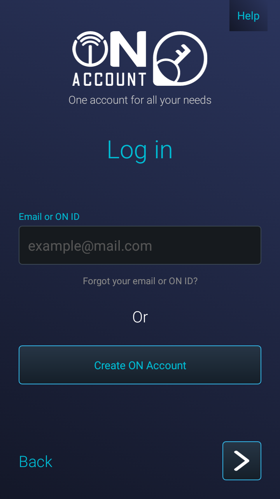
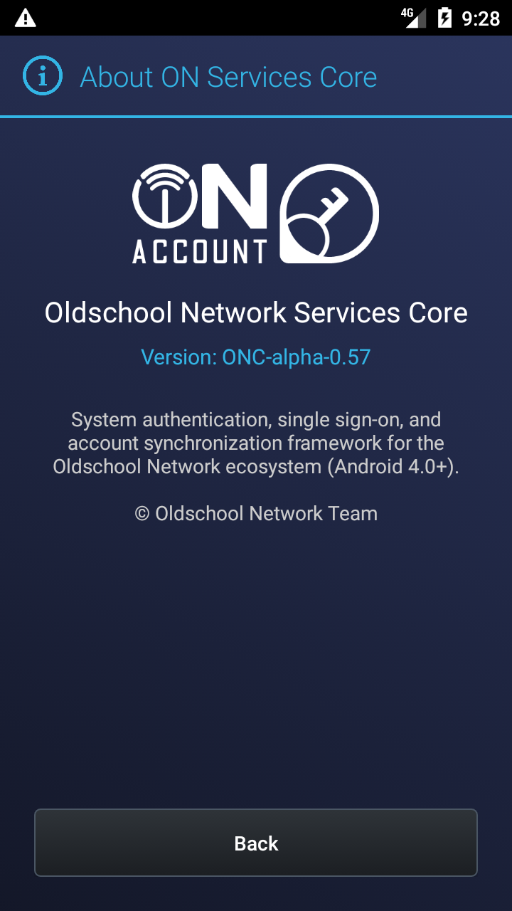

  

  <picture>
    <source media="(prefers-color-scheme: dark)" srcset="docs/branding/oldschool-network-dark.svg">
    
  </picture>

# ON Core Services

The account and shared service layer for Oldschool Network on classic Android devices.

Current alpha: **0.57** (version code 12). Android 4.0 / API 14 or later.

## Screenshots

  
  

## Features

- ON Account sign-in and saved-account selection.
- Profile and avatar editing, account preferences, active sessions and support requests.
- Android Settings account integration and onboarding.
- Core and Store update checks, with separate controls for scheduled checks and automatic installation. Silent installation requires compatible full system setup.

## Downloads

Get signed APKs from [GitHub Releases](https://github.com/OldschoolNetwork/core/releases). Use [All downloads](https://oldschoolnetwork.online/downloads/) for individual services and archived versions. The main Download button provides the Classic Installer.

## Installation

Read the [installation guides](https://oldschoolnetwork.online/downloads/docs/categories/installation/). Full system setup requires a compatible rooted device; ordinary installation uses Android's package installer. Update an existing installation with APKs signed by the same certificate.

This is alpha software. Physical-device and firmware compatibility can differ from emulator results.

## Project

[Website](https://oldschoolnetwork.online/) · [Help](https://oldschoolnetwork.online/downloads/docs/) · [Platform Rules](https://api.oldschoolnetwork.online/v1/on-account/web/terms.html)

[Bluesky](https://bsky.app/profile/oldnet.bsky.social) · [YouTube](https://www.youtube.com/@oldschoolnetwork) · [X](https://x.com/oldschool_net) · [Telegram](https://t.me/OldschoolNetwork)
